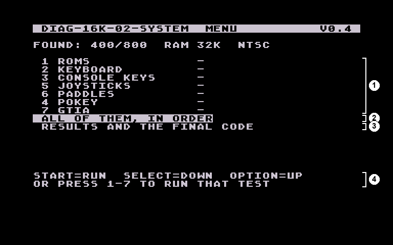

# A8 Cassette Diagnostics

Diagnostic tapes for every Atari 8-bit computer: the 400, 800, 1200XL,
600XL, 800XL, 65XE, 800XE, 130XE and XE Game System. Load one like
any cassette program and it tests the machine: RAM, ROMs, keyboard, console
keys, joysticks, paddles, sound and video, plus a memory test (burn-in) for faults that
come and go.

It reports by **border colour and beeps** first, so it works even when the
picture doesn't. Text appears on screen once the screen itself has been
checked.

**Why cassette:** a cassette boot needs the least of the machine: no disk
drive, no DOS, just the computer, its OS and the first few K of RAM. So it
runs on an 8K Atari 400 and on machines too sick to boot a disk. Tape is
slow (about 3K a minute), so there are three sets, by RAM size: the more
RAM, the fewer tapes. Each set works on every machine with at least that
much RAM, newer models included. With a disk drive, the 32k+ tape and the
memory test also come as **disk files** (`.xex`, in `disks/`) that load in
seconds. All of it is also on one **cartridge** (in `carts/`): plug it in,
switch on, pick a test.

Version 0.4. Every file has its version in its name
(`diag-32k-xl-xe-v0.4.xex`) and every screen shows it at the right of the
title bar (`V0.4`), so you can tell which one you are running. The names
below leave the `-v0.4` out.

## Get started

1. Pick the tapes by RAM: the biggest set the machine has the RAM for.

   | RAM | Tapes (in `cassettes/`) |
   |---|---|
   | 8K or more (every Atari) | the 400 set: `diag-400-01-ram` to `diag-400-05-av`, about 2 min each; long test `diag-400-memtest` |
   | 16K or more | the 16k set: `diag-16k-01-ram`, `diag-16k-02-system`, about 3.5 min each; long test `diag-memtest` |
   | 32K or more (an 800 with 32K-48K, any 64K or 128K XL/XE) | the 32k+ tape: `diag-32k-xl-xe`, one tape, about 6 min; long test `diag-memtest` |
   | keyboard, joysticks, paddles only (16K or more) | `diag-controls`: no test harness needed; goes with Atari's SALT disks |
   | with a disk drive or a MiSTer: 32K or more | `disks/diag-32k-xl-xe.xex` (the 32k+ tape); long test `disks/diag-memtest.xex` (16K) |
   | a MiSTer, or an AtariMax 128K flash cartridge: 16K or more | `carts/diag-cart.car`: the 32k+ tests (32K) and the long test (16K) behind one menu |

   A machine that won't get through its own set: use the 400 set. A tape
   that needs more RAM than the machine has stops at once: red border, a
   low tone on and off.

2. Take out any cartridge, then load the first tape: hold START, switch the
   machine on, start the tape and press a key when it beeps. You can
   use a MiSTer, a PC with a USB-SIO cable and AspeQt, or a real cassette.
3. Watch and listen: green is good, red plus beeps is a fault. Long beeps
   say where (RAM bank or test number), short beeps say what (data bit or
   item).

**[The user guide](docs/USER-GUIDE.md)** explains every screen, the colours
and beeps, loading from a PC, and what to do when something fails.

## Versions

- **0.4** (2026-11-14)
  - Fixed: a real 800 could be taken for an XL/XE. The test looked at what
    `$C000` reads, where a 400/800 has nothing, and an idle bus can read
    back anything. Then the ROM test compared the OS with the XL/XE tables
    (`UNKNOWN`, with sums that changed from run to run) and only joystick
    and paddle ports 1-2 were tested. The machine is now told apart by the
    direction of the PIA's port B, which the OS sets: outputs on an XL/XE,
    inputs on a 400/800.
  - Quieter once the picture is confirmed (a key at the video check; on
    the tapes without one, the display checks passing). A fault's beep code
    plays once, then the border stays steady red and silent, and SELECT
    plays the code again. The border doesn't flash while the text is up.
    The end of a tape stays green and silent. The memory test doesn't beep
    after each pass. Without a confirmed picture, and with full-screen
    flashes (OPTION), everything is as before.
  - A key now counts between the beeps of a code, not only in the pause
    after it.
  - The menu no longer blanks the screen when the highlight moves.
  - POKEY test: a new item 7, noise. After the four voices, voice 1 plays
    as a hiss; a POKEY whose polynomial counter is dead plays the pure
    tones but not this.
  - The version is in every file name and on every title bar.
  - Fixed: the 130XE check left a wrong byte at `$4000` in the 32k+
    tape, disk file and cartridge (one wrong character in the GTIA test).
  - Fixed: the tapes without a RAM test accepted a screen block with a bit
    stuck through all of it, and showed garbled text.
  - Fixed: with no working screen block, the console key test wrote its
    text over page zero and crashed.
  - The cartridge menu: too little RAM for one program shows the message
    and comes back to the menu, so the other can still be picked.
  - The video check shows all 64 characters, normal and inverse.
  - `diag-400-memtest` no longer shows the character ROM sum (no room in
    8K); `diag-400-01-ram` shows it.
- **0.3** (2026-11-08)
  - Fixed: on a 130XE the 32k+ tape and `diag-32k-xl-xe.xex` crashed as
    the RAM test went from the RAM under the OS to extended bank 5. Their
    stage 2 kept its working storage at $4F00, inside the $4000-$7FFF
    window that a 130XE bank switch takes over, so switching in bank 5 lost
    it. That storage now sits in low RAM ($0600). The same mistake made
    their FOUND line say `RAM 64K` on a 130XE; it now says 128K. The other
    tapes and `diag-memtest.xex` are byte for byte the same as 0.2.
  - The cartridge, `carts/diag-cart.car` (AtariMax 128K, `.car` type 41):
    START runs the 32k+ tests (RAM, ROMs, keyboard, console keys,
    joysticks, paddles, sound, video), SELECT the long memory test. The
    title bars say CART.
- **0.2** (2026-11-08)
  - Disk files: `diag-32k-xl-xe.xex` (32K) and `diag-memtest.xex` (16K),
    for DOS 2.0S/2.5, MyDOS, the MiSTer's XEX loader, AspeQt and FujiNet.
    The same tests as their tapes; the title bar says XEX. A machine with
    too little RAM, or a DOS in the way, gets a plain message before the
    file loads.
  - The tapes are unchanged (byte for byte the same as 0.1.2).
- **0.1.2** (2026-11-08)
  - Every tape that needs more than 8K checks the RAM first. On a machine
    with too little it stops at once, with a red border and a low tone on
    and off, instead of giving a meaningless code.
  - The documents pick tapes by RAM, for every Atari 8-bit model.
  - The leftover code of the old 48k+ tape is gone (the other tapes are
    unchanged by that).
- **0.1.1** (2026-11-08)
  - The 16k RAM tape and the 32k+ tape (it replaces the 48k+ tape) are one
    load each, and test their own RAM too. The 32k+ menu has `0 RAM TEST
    AGAIN`.
  - The machine's real RAM is reported (64K on an 800XL, 128K on a 130XE),
    a plugged-in cartridge shows as `CART IN`, and XL/XE BASIC is switched
    off for the RAM test.
  - Every screen's title bar names the tape; the `FOUND:` line below it is
    what the tape detected.
  - GTIA test: the word ATARI in players and missiles, scrolling, with a
    display-list-interrupt rainbow.
  - New `diag-controls` tape: keyboard, joysticks and paddles only.
  - At the end of a tape, START runs the tests again; the ROM test waits for
    a key so you can read it; the summaries name the next tape.
  - The burn-in is renamed the memory test (`diag-memtest`,
    `diag-400-memtest`).
  - Fixed: the keyboard test's stray lines on the INV key; a scrambled
    screen in the 32k+ tape's ROM test on the XL/XE.
- **0.1** (2026-11-07): the first release.

## For developers

[docs/DEVELOPMENT.md](docs/DEVELOPMENT.md) covers building from source, the
simulator, the source layout and the attributions. The design notes are in
[Atari-diag-cassette-scope.md](Atari-diag-cassette-scope.md).

## Authorship and status

The author has programmed 6502 machine language and assembler since
childhood. Even so, all of the code and documents here are, for now, 100%
written by AI (Claude, by Anthropic). The author directs the work, reviews
it and tests it on hardware.

Tested on a MiSTer Atari800 core and in the project's
simulator; not yet on a real 400, 800, XL or XE. Issues and pull requests
are the way to reach the author; email is not checked.
