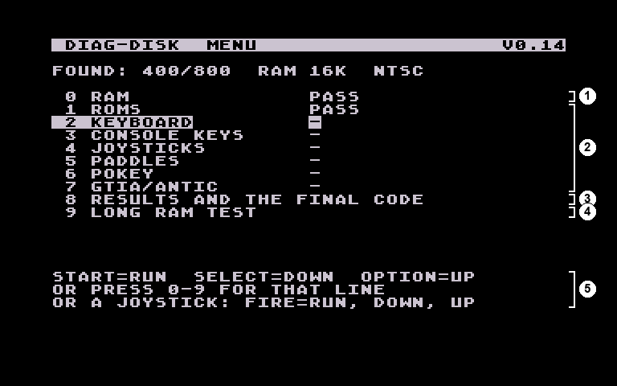

# A8 Atari Diag Suite

By **Michael Grimm**, written with Claude (Anthropic's AI). Free to use,
copy, change and share under the [MIT license](LICENSE); please keep the
credit when you pass it on.

Diagnostics for every Atari 8-bit computer: the 400, 800, 1200XL, 600XL,
800XL, 65XE, 800XE, 130XE and XE Game System. They test the RAM, the
ROMs, the keyboard, the console keys, the joystick and paddle ports, the
sound chip (POKEY) and the video chips (GTIA and ANTIC), and there is a
long memory test (burn-in) for faults that come and go.

It reports by **border colour and beeps** first, so it works even when the
picture doesn't. Text appears on screen once the screen itself has been
checked. Every result waits for you, for as long as you like, except the
RAM summary where the ROM test comes next: it plays its code three times
and goes on by itself, so a machine left alone runs on to the ROM test.

## Ways to run it

All of them show the same tests, screens, colours and beeps. **Start
with the boot disk:** it is the most convenient. It boots on any Atari
with 8K or more and a disk drive or an SIO adapter, with no DOS, and it
works like the cartridge (the same menu, keys and results), only each test
loads from the disk when you pick it. **The cartridge** needs no loading
at all: it runs from ROM, so it works on a machine whose RAM is too sick
to load a program, but it needs a flash cartridge. **The disk set** is the
8k tapes as disks, one test to a disk with no menu: when the boot disk
won't get far on a sick machine, each test still boots on its own. The
cassettes are the other way in, and need the least of the machine. All but the cartridge
cost nothing (no flash cartridge to buy), and they are the way in when the
cartridge port itself is bad.

| | File | Needs | What it is |
|---|---|---|---|
| **Boot disk** | `disks/diag-disk.atr` | any Atari (8K) with a disk drive or an SIO adapter | the cartridge's menu from a disk you boot: no DOS; each test loads as you pick it; the long test and the "hello" with 16K |
| **Cartridge** | `carts/diag-cart.car` | any Atari (8K); an AtariMax 128K flash cartridge | every test on one menu, run from ROM: no loading, and it works when the RAM is too sick to load a program into |
| **Disk set** | `disk-set/diag-8k-01-ram.atr` to `diag-8k-06-video.atr`, `diag-8k-memtest.atr` | any Atari (8K) with a disk drive or an SIO adapter | the 8k tapes as disks, the same programs: one test to a disk, no menu, no DOS. With 16K or more the RAM disk tests the rest by itself, the sound disk adds the "hello", and the memtest disk runs `diag-16k-memtest` |
| **Memory test disk** | `disks/diag-16k-memtest.atr` | 16K; a disk drive or an SIO adapter | boots straight into the long memory test (`diag-16k-memtest`) |
| **BASCRC disk** | `disks/diag-bascrc.atr` | the BASIC cartridge in (or an XL/XE's built-in BASIC); a disk drive or an SIO adapter | boots to the BASIC check on its own (BASCRC), no DOS; on it for DOS too: `BASCRC.XEX`, the same check, and `BASCRC.LST`, the BASIC listing |
| **Cassette** | the 8k set: `diag-8k-01-ram` to `diag-8k-06-video` | 8K: every Atari | six small tapes, about 2 minutes each; long test `diag-8k-memtest` (400/800) |
| | the 16k set: `diag-16k-01-ram`, `diag-16k-02-system`, `diag-16k-03-hello` | 16K | about 3-3.5 minutes each; long test `diag-16k-memtest` |
| | `diag-32k-xl-xe` | 32K | one tape, about 6 minutes: the RAM test, then every test with the menu |
| | `diag-controls` | 16K | keyboard, joysticks and paddles only: goes with Atari's SALT disks, no test harness needed |
| | `diag-bascrc` | BASIC cartridge in | BASCRC as a BASIC listing (`ENTER "C:"`); also on the BASCRC disk as `BASCRC.LST`, for `ENTER "D:"` |

**Cassettes too:** a cassette boot needs the least of the machine: no disk
drive, no DOS, just the computer, its OS and the first few K of RAM. So the
tapes are there for a machine with only a recorder, or one too sick to boot
a disk. Tape is slow (about 3K a minute), so they come in sets by RAM
size: the more RAM, the fewer tapes.

Version 0.13. Every file has its version in its name
(`diag-disk-v0.13.atr`) and every screen shows it at the right of the
title bar (`V0.13`). The names here leave the `-v0.13` out.

## Get started

1. Pick a way: the boot disk if you have a disk drive or an SIO adapter
   (any Atari with 8K or more); the cartridge if you have a flash
   cartridge, or the RAM is too sick to load anything; otherwise the tapes
   for the machine's RAM (a machine that won't get through its own set:
   the 8k set). A tape that needs more RAM than the machine has stops at
   once: red border, a low tone on and off.
2. Take out any cartridge but BASIC, and load it: for the boot disk, put
   it in drive 1 (or mount it as D1:) and switch on; for a tape, hold
   START, switch on, start the tape and press a key when it beeps.
   BASIC can stay in: the ROM test (test 1) then checks it too, but the
   8K of RAM under it can't be tested (a 48K 800 shows `RAM 40K`), so
   take it out to test all the RAM.
3. Watch and listen: green is good, red plus beeps is a fault. Long beeps
   say where (the RAM bank or the test), short beeps say what (the data
   bit or the item).

Keys at every result, each with a console key and a keyboard key so one
dead key never traps you: **R** re-test (where there is no menu to pick
the test from again), **T** or SELECT the tones again, **F** or OPTION
full-screen flashes, any other key (START, a joystick button) goes on.
**S** skips the RAM test on the boot disk, the cartridge and the 32k+
tape.
With no keyboard, a joystick in port 1 or 2 stands in for the console
keys on every screen: fire = START, down = SELECT, up = OPTION. A stuck
joystick (a short) gets three "pew" beeps and orange flashes at
switch-on, and is then ignored: only a new press counts.

**Dirty contacts cause a lot of "faults".** An unpaid recommendation from
the author: DeoxIT contact cleaner (CAIG Laboratories) on the cartridge
port, the cartridge's own contacts, the SIO and joystick connectors, and
an 800's RAM and OS board edges. Clean, reseat, and test again before
blaming a chip.

**[The user guide](docs/USER-GUIDE.md)** explains every screen, the colours
and beeps, loading from a disk drive or a PC, and what to do when something
fails. It starts with a table of every test and the files that have it.

## Status

Tried on a real 800 and a real 800XL with the executables (`.xex`, up to 0.11) over
an SIO adapter, where the joystick and paddle ports get their real test. Every
format, the boot disk included, has also run on the author's development
set-up, the MiSTer's Atari800 core, as a 400/800 and as an XL/XE (64K, and
a 128K 130XE). Not tried on a real machine yet: the boot disk, the
cartridge and the cassettes. Reports from other machines are welcome.

## Versions

- **0.13** (2026-11-19), against 0.12:
  - **The disk set** (`disk-set/`, new): the 8k tapes as disks, named as
    the tapes (`diag-8k-01-ram.atr` to `diag-8k-06-video.atr`,
    `diag-8k-memtest.atr`), one test to a disk, no menu and no DOS. When
    the boot disk can't get far on a sick machine, each test still boots
    on its own, as from tape. They hold the tapes' own programs, byte for
    byte, so each title bar and `NEXT:` line names the disk to load next.
    With 16K or more the RAM disk loads its part 2 from the disk by
    itself, the sound disk plays the sampled "hello" too (POKEY item 7),
    and the memtest disk runs `diag-16k-memtest`.
  - **The long memory test on a disk of its own**
    (`disks/diag-16k-memtest.atr`, new): it boots straight into
    `diag-16k-memtest`.
  - **The ROM test checks a BASIC cartridge itself:** the tapes and the
    disks run with BASIC in (the OS boots them before it would start
    BASIC, and they never hand it back), so test 1 reads a cartridge at
    $A000 and names BASIC rev A, B or C, as it does an XL/XE's built-in
    BASIC; any other cartridge shows `UNKNOWN` (item 2). With BASIC in,
    the 8K of RAM under it can't be tested (a 48K 800 shows `RAM 40K`).
  - **`diag-16k-03-hello` is the whole sound test** (test 6) with the
    sampled "hello", not the "hello" alone: the same test the disk set's
    sound disk runs on 16K. The hello-only build is gone.
  - **The "hello" recording is packed** to half its size (each sample a
    4-bit step from the one before) and unpacked as it plays, the same
    in every format: `diag-16k-03-hello` loads in about 3 minutes (64
    records, not 92), the boot disk reads 30 sectors for it, not 58.
  - **BASCRC stays** (its disk and its tape), as the BASIC check on its
    own: with the diag cartridge, which can't read a BASIC cartridge, or
    as a second opinion.
  - **The paddle test has no fast scan** (SELECT did it): POKEY's fast
    scan can't read paddles (the counts come out 114 times too high, and
    it turns off the transistors that empty the paddle capacitors, so the
    values freeze).
  - **The video modes page's VSCROL line moves a scan line at a time,**
    up and down: 0.12's jumped 7 lines at the top of its swing.
  - **The long memory test checks the refresh** (16K and up: the
    cartridge, the boot disk, `diag-16k-memtest`): once a pass it fills
    the RAM, switches the screen off and leaves the RAM alone for 5
    seconds, twice ($00, then $FF), so only ANTIC's refresh keeps it,
    then reads it back. The march can't see a refresh fault, since every
    access refreshes the row it touches: for example a replacement RAM
    chip that needs more rows refreshed than an older ANTIC does. The
    screen going off for those seconds is the check.
- **0.12** (2026-11-18), against 0.11:
  - **A stuck joystick's signal is friendlier:** three short "pew" beeps,
    like a toy ray gun, each with the screen flashing bright orange (about
    half a second), in place of 0.11's buzz and blue sparks, which sounded
    like a fault in the machine. The boot disk gives it in its boot
    sectors, before the RAM test loads.
  - **The menus lose `ALL OF THEM, IN ORDER`:** START, START... still walks
    the tests, as the next one is highlighted after each. A machine with no
    picture still runs them all in order.
  - Smaller: the boot disk's loader carries only what each piece uses (the
    boot's loads one way and has no screen; only the RAM pieces and the
    sound piece keep the whole one), and the menus are shorter.
  - **BASCRC has a disk of its own** (`disks/diag-bascrc.atr`, new): it
    boots straight into the BASIC cartridge check, in machine code, with
    no DOS; after a key the machine goes on to BASIC's `READY`. It is a
    DOS 2 disk too, with `BASCRC.XEX` (the same check, `L` from DOS) and
    `BASCRC.LST` (the BASIC listing, `ENTER "D:BASCRC.LST"`).
  - **No more executables** (`.xex`, the `xex/` folder): the boot disk does what
    `diag-32k-xl-xe.xex` and `diag-16k-memtest.xex` did, and BASCRC's
    disk carries `diag-bascrc.xex` and `bascrc.lst`. The 32k+ program and
    the long memory test are still tapes too.
  - The user guide shows test 7's second page, the video modes.
- **0.11** (2026-11-17), against 0.10:
  - **The joystick on every screen:** fire goes on, down plays the tones
    again (SELECT), up switches the flashes (OPTION), at every result as
    well as on the menu and the questions. Only a new press counts, so a
    held or stuck stick never holds a screen up (in 0.10 a stuck button
    froze the result screens). `diag-8k-memtest` takes fire only (no room).
  - **A stuck joystick shows at switch-on:** a direction or the button in
    port 1 or 2 already active (a short) gets about a second of buzz and
    crackle, the screen near black and flashing blue, before the green
    chirp. Every tape, the disks and the cartridge, but `diag-8k-memtest`.
  - Boot disk: test 6's voices 3 and 4 were silent (each disk load left
    POKEY in the serial mode that holds them). The disk error screen takes
    START and fire as a new press only.
  - `disks/` holds only the boot disk; the executables (`.xex`) and
    BASCRC's `.lst` are in `xex/`.
  - The user guide starts with the boot disk and the cartridge; the disk
    files and the cassettes follow, as the other ways in.
- **0.10** (2026-11-17), against 0.9:
  - **The boot disk** (`diag-disk.atr`, new), the place to start: the
    cartridge's menu from a disk you boot, on any Atari with a disk drive
    or an SIO adapter, 8K and up, no DOS. The RAM test is one part on
    every machine (it tests its own RAM page by page, as the long test
    does); each test loads from the disk as you pick it.
  - **The RAM summary goes on by itself** where the ROM test comes next
    (the boot disk, the cartridge, the 32k+ tape and executable): after its
    code has played three times, so a machine left alone runs on to the
    ROM test. Any key goes on at once; T or OPTION stops the count.
  - **Joystick as the console keys** (no keyboard): fire = START, down =
    SELECT, up = OPTION, in port 1 or 2: the menu, the yes/no questions,
    the end of the keyboard test and the console key test's "one dead"
    escape. A held or stuck stick counts once.
  - The title bar's version has room for two digits after the point.
  - Documents: start with the boot disk; the MiSTer is named only as the
    development set-up, not as a machine to test.
- **0.9** (2026-11-15), against 0.8:
  - **Keys:** R re-test, T or SELECT the tones, F or OPTION full-screen
    flashes, any other key goes on, at every result; every action has a
    console key and a keyboard key. S skips the RAM test on the cartridge,
    the 32k+ tape and the executable; X skips the console key test.
  - **No timers:** no result moves on by itself any more (a pass used to
    go on after 2 seconds). R works at the last screen of every tape
    without a menu (all its tests again), at the RAM summaries and at the
    memory test's summary.
  - **The end of a tape without a menu:** a line for each of its tests and
    what to load next, for example `DONE. R=RETEST. NEXT:
    DIAG-8K-04-PORTS`.
  - **Sounds:** a fail plays "impending doom" (C4, C4, F#3, the tritone)
    before its code, instead of the sad trombone. A final result with
    nothing failed but not every test run is steady yellow with the
    start-up chirp.
  - **The 8k set** is six tapes: the sound and video tape became
    `diag-8k-05-sound` and `diag-8k-06-video`, one load each.
  - **ROM test:** a self-check (item 6): a tape or executable checks its own
    copy in RAM by CRC32, the cartridge each of its program banks. The
    XL/XE's built-in BASIC must match a revision (item 2). The 400/800's
    BASIC cartridge is checked by **BASCRC** instead: an executable, a BASIC
    listing on tape and a `.lst` file.
  - **RAM:** one long beep per 16K bank at a pass (the 32k+ tape and disk
    file left bank 1 out, so a 130XE beeped 7 times, not 8). The cartridge
    counts the RAM under itself at every start (48K, not 40K, after S or
    the long test). The `FOUND:` line no longer says `CART IN`.
  - **Memory test:** the count is passes done, from 0; a key shows `ENDING
    AFTER PASS`; R starts it again. `diag-memtest` is now
    `diag-16k-memtest` (tape and executable); the 32k+ executable no longer
    carries it. `diag-8k-memtest` stops at once on an XL/XE (yellow,
    `XL/XE: USE DIAG-16K-MEMTEST`): it can't reach their extra RAM.
  - **Test 7 is GTIA/ANTIC:** the word ATARI scrolls right to left and
    snakes on its own wave; page 2 shows the video modes (ANTIC 6 and 7,
    the bitmaps 8, A, B, D, F, GTIA 9, 10, 11) and fine scrolling.
  - **"hello"** plays the cartridge's 15.7 kHz recording everywhere it is
    (cartridge, executable, `diag-16k-03-hello`), seven plays.
  - The keyboard test ends on any console key; the Atari key shows the
    logo on every machine.
  - Documents: a keys section and a table of every test by file, the MIT
    license, and current pictures.
- **0.8** (2026-11-15)
  - The 400 set is now the 8k set: `diag-8k-01-ram` to `diag-8k-05-av` and
    `diag-8k-memtest`. It runs on any Atari, tells a 400/800 from an XL/XE
    and tests every RAM bank the machine has.
  - Sounds: a pass plays the first four notes of the "charge" fanfare
    (twice for the final pass); a fail plays a sad trombone (two long
    falling notes) before its beep code.
  - The executable loads on 32K again (0.7 needed 34K): its "hello" is now
    4 bits, a quarter of the bytes, played on the four voices and the
    speaker. The cartridge keeps its 15.7 kHz version and the two-voice
    plays.
  - `diag-16k-03-hello`: the sampled sound test on its own tape (too big
    for 8K).
  - GTIA test: the sixteen colour bands are bigger (5 lines, from 3) and
    the gray steps smaller (3 lines, from 7). The ATARI letters snake: each
    rides the wave a little behind the one before, on every version (the
    wave is a 16-byte quarter table).
- **0.7** (2026-11-14)
  - The ROM test runs by itself only at power on; the RAM test run from
    the menu comes back to the menu. The RAM summary waits for START.
  - S skips the RAM test (cartridge), X skips the ROM test (cartridge,
    executable, 32k+ tape) and the console key test. A tap counts any time,
    from switching on.
  - "hello" plays with the screen off, at a steady rate: a sample every
    scan line on the cartridge (15.7 kHz, in a bank of its own), every
    other line on the disk. 0.5 and 0.6 played it with the screen on,
    which made the samples late and uneven. The recording is prepared
    properly now (`tools/mkhello.py`, with a preview to listen to on a PC).
  - GTIA test: on the cartridge the ATARI sprites bounce as well as scroll.
  - A tap of START right as a result appeared could be missed; fixed.
  - Smaller: the code every part shares (the beep reporter, the screen,
    the machine line, the RAM test engine) is now in the one-load images
    once instead of two or three times. The 32k+ program is 13.5K (was
    16.5K) and fits below $4000; the 16k RAM tape is 6K (was 8K); the
    cartridge's RAM bank has 2K more room. Screen rows and the GTIA rainbow
    are worked out instead of looked up, and the system tests keep their
    data in zero page.
- **0.6** (2026-11-14)
  - After the RAM test the ROM test runs by itself, then the menu. On the
    cartridge CTRL+X during the RAM test goes straight to the menu.
  - Menu: 8 is the results, 9 the long memory test. Re-running the RAM
    test (0) keeps the other tests' results.
  - The long memory test returns to the cartridge's menu (START at its
    summary).
  - The executable `diag-32k-xl-xe.xex` now holds the long memory test too
    (menu line 9) and the sampled "hello"; it needs 34K.
  - "hello" also plays on two voices at once, for twice the levels.
  - CTRL+X skips the console key test. A tap of START is no longer missed
    now and then at a result screen.
  - The results screen explains the numbers after FAIL; the guide lists
    every test's items.
- **0.5** (2026-11-14)
  - The cartridge runs from ROM: it needs 8K of RAM, not 32K, and works on
    a machine whose RAM can't hold a program. Power on goes straight into
    the RAM test; the START/SELECT start screen is gone. Only the long
    memory test (menu line 8) copies itself to RAM. The RAM test also tests
    the 8K under the cartridge (it switches itself off for a moment), so a
    48K machine shows as 48K.
  - CTRL+S skips the first RAM test on the cartridge (a tap any time
    during it).
  - The cartridge's ROM test also checks an XL/XE's built-in BASIC (it
    switches itself off to read it), and its POKEY test plays a sampled
    "hello" on each voice and the console speaker (item 7).
  - One menu, numbered in order: 0 RAM, 1 ROMs, 2 keyboard, 3 console
    keys, 4 joysticks, 5 paddles, 6 POKEY, 7 GTIA (and 8, the long memory
    test, on the cartridge). Joysticks, paddles and POKEY changed numbers.
  - No video check screen. The RAM result is the first screen, and START
    there says the picture can be read.
  - Beep codes only for the RAM and the ROMs, in different pitches. Other
    tests show their result: a jingle for a pass, one low beep for a fail.
  - Keyboard test: the key click sounds on the console speaker and POKEY.
  - POKEY test: each voice plays a scale, then noise.
  - Keyboard test: on a 400/800 the Atari logo key shows as `/|\`, not INV.
  - GTIA test: ramps and sprites on one screen, one question.
  - ROM test: the cartridge slot is named only for BASIC A, B and C; the
    diagnostic cartridge names itself.
  - The 16K and 32K images are smaller (an unused results screen removed).
- **0.4** (2026-11-14)
  - Fixed: a real 800 could be taken for an XL/XE. The test looked at what
    `$C000` reads, where a 400/800 has nothing, and an idle bus can read
    back anything. Then the ROM test compared the OS with the XL/XE tables
    (`UNKNOWN`, with sums that changed from run to run) and only joystick
    and paddle ports 1-2 were tested. The machine is now told apart by the
    direction of the PIA's port B, which the OS sets: outputs on an XL/XE,
    inputs on a 400/800.
  - Quieter once the picture is confirmed (a key at the video check; on
    the tapes without one, the display checks passing). A fault's beep code
    plays once, then the border stays steady red and silent, and SELECT
    plays the code again. The border doesn't flash while the text is up.
    The end of a tape stays green and silent. The memory test doesn't beep
    after each pass. Without a confirmed picture, and with full-screen
    flashes (OPTION), everything is as before.
  - A key now counts between the beeps of a code, not only in the pause
    after it.
  - The menu no longer blanks the screen when the highlight moves.
  - POKEY test: a new item 7, noise. After the four voices, voice 1 plays
    as a hiss; a POKEY whose polynomial counter is dead plays the pure
    tones but not this.
  - The version is in every file name and on every title bar.
  - Fixed: the 130XE check left a wrong byte at `$4000` in the 32k+
    tape, executable and cartridge (one wrong character in the GTIA test).
  - Fixed: the tapes without a RAM test accepted a screen block with a bit
    stuck through all of it, and showed garbled text.
  - Fixed: with no working screen block, the console key test wrote its
    text over page zero and crashed.
  - The cartridge menu: too little RAM for one program shows the message
    and comes back to the menu, so the other can still be picked.
  - The video check shows all 64 characters, normal and inverse.
  - `diag-8k-memtest` no longer shows the character ROM sum (no room in
    8K); `diag-8k-01-ram` shows it.
- **0.3** (2026-11-08)
  - Fixed: on a 130XE the 32k+ tape and `diag-32k-xl-xe.xex` crashed as
    the RAM test went from the RAM under the OS to extended bank 5. Their
    stage 2 kept its working storage at $4F00, inside the $4000-$7FFF
    window that a 130XE bank switch takes over, so switching in bank 5 lost
    it. That storage now sits in low RAM ($0600). The same mistake made
    their FOUND line say `RAM 64K` on a 130XE; it now says 128K. The other
    tapes and `diag-memtest.xex` are byte for byte the same as 0.2.
  - The cartridge, `carts/diag-cart.car` (AtariMax 128K, `.car` type 41):
    START runs the 32k+ tests (RAM, ROMs, keyboard, console keys,
    joysticks, paddles, sound, video), SELECT the long memory test. The
    title bars say CART.
- **0.2** (2026-11-08)
  - Executables: `diag-32k-xl-xe.xex` (32K) and `diag-memtest.xex` (16K),
    for DOS 2.0S/2.5, MyDOS, the MiSTer's XEX loader, AspeQt and FujiNet.
    The same tests as their tapes; the title bar says XEX. A machine with
    too little RAM, or a DOS in the way, gets a plain message before the
    file loads.
  - The tapes are unchanged (byte for byte the same as 0.1.2).
- **0.1.2** (2026-11-08)
  - Every tape that needs more than 8K checks the RAM first. On a machine
    with too little it stops at once, with a red border and a low tone on
    and off, instead of giving a meaningless code.
  - The documents pick tapes by RAM, for every Atari 8-bit model.
  - The leftover code of the old 48k+ tape is gone (the other tapes are
    unchanged by that).
- **0.1.1** (2026-11-08)
  - The 16k RAM tape and the 32k+ tape (it replaces the 48k+ tape) are one
    load each, and test their own RAM too. The 32k+ menu has `0 RAM TEST
    AGAIN`.
  - The machine's real RAM is reported (64K on an 800XL, 128K on a 130XE),
    a plugged-in cartridge shows as `CART IN`, and XL/XE BASIC is switched
    off for the RAM test.
  - Every screen's title bar names the tape; the `FOUND:` line below it is
    what the tape detected.
  - GTIA test: the word ATARI in players and missiles, scrolling, with a
    display-list-interrupt rainbow.
  - New `diag-controls` tape: keyboard, joysticks and paddles only.
  - At the end of a tape, START runs the tests again; the ROM test waits for
    a key so you can read it; the summaries name the next tape.
  - The burn-in is renamed the memory test (`diag-memtest`,
    `diag-8k-memtest`).
  - Fixed: the keyboard test's stray lines on the INV key; a scrambled
    screen in the 32k+ tape's ROM test on the XL/XE.
- **0.1** (2026-11-07): the first release.

## For developers

Everything is built from source with the MADS assembler and a few Python
tools; a cycle-timed simulator runs the programs without an Atari.
[docs/DEVELOPMENT.md](docs/DEVELOPMENT.md) covers the environment,
building, the source layout, the simulator, how each format is put
together, the rules the code keeps (byte budgets, no timeouts, two keys for
everything) and the lessons learned along the way.
[Atari-diag-cassette-scope.md](docs/design/Atari-diag-cassette-scope.md) is the design
and the ROM table; [Atari-diag-boot-disk-scope.md](docs/design/Atari-diag-boot-disk-scope.md)
the boot disk's, and [Atari-diag-disk-scope.md](docs/design/Atari-diag-disk-scope.md)
the disk set's.

Contributions are welcome: issues and pull requests on GitHub are the way
to reach the author (email isn't checked). A report from real hardware is
as useful as code: say which machine, OS and RAM, which file, and what the
screen and the beeps said.

## Credits

- **Michael Grimm:** the author. He directs the work, reviews it and tests
  it on hardware, and wrote BASCRC, the BASIC cartridge check.
- **Claude** (Anthropic's AI): wrote the code, the tools and the
  documents, under his direction.
- **Other people's work** this builds on (details in
  [DEVELOPMENT.md](docs/DEVELOPMENT.md#attributions)):
  - [MADS](https://github.com/tebe6502/Mad-Assembler), the assembler, by
    Tomasz Biela (Tebe);
  - [py65](https://github.com/mnaberez/py65), the 6502 core in the
    simulator, by Mike Naberezny; [Pillow](https://python-pillow.org/) for
    the pictures;
  - the ROM tables: the [atari800](https://github.com/atari800/atari800)
    emulator, [MAME](https://github.com/mamedev/mame) and Freddy Offenga's
    *Atari 8-bit Operating Systems* (OSROMS.TXT);
  - the "hello" recording: `En-us-hello.ogg` by Dvortygirl, Wikimedia
    Commons, public domain;
  - the [MiSTer Atari800 core](https://github.com/MiSTer-devel/Atari800_MiSTer)
    and [AspeQt](https://sourceforge.net/projects/aspeqt/), which the
    testing relies on;
  - prior art: Atari's SALT and Super SALT diagnostic disks, and Sys-Check.

No Atari ROM code is included. The simulator and the pictures used the
author's own ROM files, which are not distributed here.

## Authorship

The author has programmed 6502 machine language and assembler since
childhood. Even so, all of the code and documents here are, for now, 100%
written by AI (Claude, by Anthropic). The author directs the work, reviews
it and tests it on hardware.
