# A8 Atari Diag Suite: User Guide

By **Michael Grimm**, written with Claude (Anthropic's AI). Free to use,
copy, change and share under the [MIT license](../LICENSE); please keep
the credit when you pass it on.

Version 0.14. Every file has its version in its name
(`diag-disk-v0.14.atr`), and every screen at the right of its title bar
(`V0.14`). If the two don't match, or a screen shows none, the file is an
older one. This guide leaves the `-v0.14` out of the names.

These programs test any Atari 8-bit computer: the 400, 800, 1200XL, 600XL,
800XL, 65XE, 800XE, 130XE and XE Game System. They report by colour and
beeps first, and with text once the screen itself has been checked, so
they still help when the picture is bad. No programming is needed. There
are four ways to run them, all with the same screens, colours and beeps.
**The cartridge is the best test:** it runs from its own ROM, so it needs
the least RAM and nothing loads: plug it in and go. It takes an AtariMax
flash cartridge (the 128K one, or the 8 Mbit MaxFlash), which you may
have already. The disks and the cassettes are the free ways (and the way
in when the cartridge port is bad); of those, start with the boot disk:

| Way | File | Needs | What it is |
|---|---|---|---|
| **The cartridge** | `carts/diag-cart.car` (AtariMax 128K) or `carts/diag-cart-8mbit.bin` (8 Mbit MaxFlash) | 8K; an AtariMax flash cartridge | the best test: every test on one menu, run from its own ROM: nothing to load, so it works when the RAM is too sick to load a program. See [From the cartridge](#from-the-cartridge) |
| **The boot disk** | `disks/diag-disk.atr` | 8K; a disk drive or an SIO adapter (SIO2PC, SIO2SD, FujiNet); no DOS | the most convenient free way: every test on one menu, each loaded from the disk as you pick it. See [From the boot disk](#from-the-boot-disk) |
| **The disk set** | `disk-set/diag-8k-*.atr` | 8K; a disk drive or an SIO adapter | the 8k tapes as disks, one test to a disk, no menu: for a machine the boot disk can't get far on. See [The disk set](#the-disk-set) |
| **Cassettes** | `cassettes/*.cas` | a cassette recorder, or a PC playing the tape | no disk drive needed: a tape still loads where a disk won't boot. See [Cassettes](#cassettes) |

With a disk or a tape, take any cartridge out, BASIC too: the RAM under
it can't be tested while it's in, and out, it can't be the cause of a
fault. Check a BASIC cartridge on its own with BASCRC, from its own disk
or tape (see [BASCRC](#bascrc-the-basic-check-on-its-own)). The ROM test
still reads a cartridge left in (see [BASIC cartridges](#basic-cartridges)).

## Contents

1. [Keys](#keys)
2. [Starting up: the boot disk, the cartridge, a stuck joystick](#starting-up)
3. [Every test, and where to find it](#every-test-and-where-to-find-it)
4. [Reading the results: the screen, colours, beeps, items](#reading-the-results)
5. [The tests, screen by screen](#the-tests-screen-by-screen)
6. [When something fails](#when-something-fails)
7. [Other ways to run it: the disk set and cassettes](#other-ways-to-run-it)
8. [Questions](#questions)

## Keys

Every result screen, and every pause in a beep code, takes these keys.
Each action has a console key and a keyboard key, so one dead key never
traps you:

| Key | Does |
|---|---|
| **R** | re-test, wherever there is no menu to pick the test again from: the last screen of a tape without a menu (all its tests again, no reloading), the RAM tapes' summaries (the whole RAM test again) and the memory tests' summary |
| **T**, SELECT or stick down | the tones (the beep code, or the pass tune) again |
| **F**, OPTION or stick up | full-screen flashes on and off: the whole screen flashes with the code, easier to see when the picture is garbled |
| START, any other key, or fire | go on: to the next test, or back to the menu (where a test is simply picked again). At the end of a tape without a menu, with nothing to go on to: the tones again |

Elsewhere:
- questions: Y, START or fire = yes; N, SELECT or stick down = no;
- menus: START or fire runs the highlighted line, SELECT or stick down
  moves down, OPTION or stick up moves up, and a number key runs its line;
- the keyboard test ends on a console key or fire (the keys are what it
  tests); the console key test goes on with any key or fire, and X skips
  it;
- S skips the RAM test on the boot disk, the cartridge and the 32k+ tape:
  a tap any time from switching on (line 0 then shows `SKIPPED`);
- the memory test stops after its pass on any key.

**A joystick** in port 1 or 2 works as the console keys on every screen,
for a machine with no keyboard (an XEGS without one, or a dead one): fire
= START, down = SELECT, up = OPTION. Only a new press counts: a stick held
down, or a stuck one, counts once and never holds anything up (see
[A stuck joystick](#a-stuck-joystick)). Left and right do nothing: they
are the paddles' triggers. `diag-8k-memtest` takes fire only (no room for
more).

**Nothing moves on by itself**, with one exception: the RAM summary where
the ROM test comes next (the boot disk, the cartridge and the 32k+ tape).
It plays its code three times, about half a minute, then goes on (its row
22 says so), so a machine left alone runs on to the ROM test. A key goes
on at once; T or OPTION stops the count, and then it waits. Every question
waits too, with a purple border, and a test that asks about a sound keeps
playing it until you answer.

## Starting up

### From the boot disk

`disks/diag-disk.atr` is a disk image you boot, on any Atari with 8K or
more; it needs no DOS. Mount it as D1: on an SIO adapter (AspeQt,
RespeQt, SIO2SD, FujiNet), or write it to a single-density disk (90K,
which every drive reads: 810, 1050, XF551) with a PC tool or a disk
copier. Take any cartridge out, BASIC too (see
[BASIC cartridges](#basic-cartridges)). You don't need to hold OPTION on
an XL/XE. Switch on with it in drive 1:

1. The RAM test starts at once. Its summary plays its code three times
   and goes on by itself (a key goes on at once; T or OPTION stops the
   count).
2. The ROM test loads and runs, and waits on its result.
3. The menu:


1. `0 RAM`: the RAM test again; its summary comes back to the menu (by
   itself after three codes, or at a key). The other tests keep their
   results. Its line says `PASS`, `FAIL`, `SKIPPED` (S) or `CART IN WAY`
   (see [A cartridge in the way](#a-cartridge-in-the-way)).
2. Tests 1 to 7.
3. `8`: the results and the final code.
4. `9 LONG RAM TEST`: the memory test, pass after pass until a key. It
   needs 16K (on less, the line says `NEEDS 16K`). A key at its end goes
   back to the menu, through the start-up without the RAM test (line 0
   shows `SKIPPED`); the other results are gone, as on the cartridge.
5. The keys: START runs the highlighted line, SELECT and OPTION move it,
   0-9 run a line directly, and a joystick works too. After a test the next
   line is highlighted (here test 2, after the start-up's RAM and ROM
   tests), so START, START... runs them all.

Each test loads from the disk when you pick it, and the menu loads again
after it: a few seconds each on an 810 or 1050, with `LOADING...` on row
23 meanwhile.

- **The RAM test is one part** on every machine: it tests the RAM it runs
  in too, page by page, as the memory test does. With 16K or more it is
  the 16k RAM tape's program, summary and all (the RAM under an XL/XE's OS
  and a 130XE's banks included). Under 16K (only ever a 400 or 800) it is
  a smaller one, whose results have an `OWN RAM $0800-$1BFF` line; a fault
  there beeps as bank 1.
- **The "hello"** (POKEY item 7) needs 16K; with less it is left out.
- **A disk error** (a bad sector, the drive door open): red border, a low
  tone and `DISK ERROR. A KEY TRIES AGAIN` on row 23. Any key, START or
  fire reads it again.

The title bar says `DIAG-DISK`, and the ROM test's self-check line `DIAG
DISK`.

### From the cartridge

`carts/diag-cart.car` is an AtariMax 128K cartridge image (`.car` type
41): write it to an AtariMax 128K flash cartridge with its own flasher.
For the 8 Mbit MaxFlash (1 MB) use `carts/diag-cart-8mbit.bin` instead,
the same cartridge laid out for that one (see [On an 8 Mbit
MaxFlash](#on-an-8-mbit-maxflash)). Either way the cartridge holds only
the diag tests, with no Maxflash menu in front. The tests run from the
cartridge itself, not from RAM, so it works on any Atari, an 8K 400
included, and on a machine whose RAM is too sick to load a program.
Switch on with it in:

1. The RAM test starts at once (green border and a chirp, then yellow
   while it tests) and ends on the RAM summary, which plays its code three
   times and then goes on by itself, as on the boot disk.
2. The ROM test runs next and waits on its result. A key goes to the menu.

The menu is the boot disk's, with `DIAG-CART` in the title bar (the lines
are explained under [From the boot disk](#from-the-boot-disk)):


- **The RAM under the cartridge.** A cartridge switches off the 8K of RAM
  it sits over ($A000-$BFFF), which is why a 48K machine with a BASIC
  cartridge shows 40K. This one switches itself off for a moment at every
  start to look for that RAM, so the machine shows its real size (48K, or
  64K on an XL/XE) even when the RAM test is skipped, and the RAM test
  tests that 8K too, with a fault there reported in bank 3.
- **Line 9, the memory test,** copies itself into RAM and switches the
  cartridge off while it runs, so it tests all of the RAM. At its summary
  a key (other than T) switches the cartridge back on and returns to the
  menu. The earlier results are gone by then (the test used that RAM), and
  line 0 shows `SKIPPED`.
- **The ROM test's `DIAG CART` line** is the cartridge checking each of
  its three program banks against the CRC32 stored in it. On an XL/XE it
  also checks the built-in BASIC, switching itself off for the moment it
  takes to read it.

#### On an 8 Mbit MaxFlash

`carts/diag-cart-8mbit.bin` is a raw 1 MB image: write it whole, as it
is, so the cartridge starts the tests itself. With the Atarimax USB
programmer and Maxflash Cartridge Studio: **Cartridge, Program, Maxflash
8Mbit Flash Cartridge**, and pick the `.bin` (don't add it to a workbook:
that puts the Maxflash menu in front of it). The log ends `Programming
Cycle Complete`. Things to know, from a 2.64 Studio:

- The Studio may want newer programmer firmware first ("Firmware update
  required to perform this operation"): **Tools, Update Programmer
  Firmware, Automatic Upgrade to Minimum Required Version** does it.
- If the programmer starts dropping off USB and coming back over and over
  (the log repeats `Programmer disconnected`, `Programmer connected`),
  close the Studio, unplug the programmer and plug it back in. Reading
  the cartridge back (Dump) right after programming set this off; the
  real check is the Atari itself: switch on, and the RAM test starts.

The 8 Mbit cartridge switches itself off at a different address from the
128K one, which is why it has its own file; the tests and screens are
the same, `DIAG-CART` in the title bar included.

### A stuck joystick

A joystick switch connects its line to ground, so a switch that sticks, a
pinched cable or a bad port pin reads as a press that never ends. Every
program looks for that before anything else (the boot disk as it boots):
a direction or the button in port 1 or 2 already active gets three short
"pew" beeps, like a toy ray gun, each with the whole screen flashing
bright orange, a little quicker each time (half a second in all), before
the usual green chirp. Then the tests run as normal, and the stuck line is
ignored everywhere (only a new press counts), so it can't hold up a
screen; the keyboard, the console keys and the rest of the stick still
work. Test 4 (joysticks) shows which line it is: it stays inverse with
your hands off, and the test fails with that port's number.

Don't hold a stick while switching on: that sets it off too, and so does a
controller that holds a line by itself (a driving controller, a
trackball). `diag-8k-memtest` has no room for the check; every other
tape, the disks and the cartridge have it.

## Every test, and where to find it

The boot disk and the cartridge have every test on their menu (above);
`diag-cart.car` below stands for the 8 Mbit `diag-cart-8mbit.bin` too.
The tapes and the disk set have each one too. The columns are the RAM a
file needs, and each cell lists the cartridge, then the disks, then the
tapes. A machine can use everything in its own column and in the columns
to the left of it:

| Line | Test | 8K+ | 16K+ | 32K+ |
|---|---|---|---|---|
| 0 | RAM | `diag-cart.car`, `diag-disk.atr`, `diag-8k-01-ram.atr`, `diag-8k-01-ram.cas` | `diag-16k-01-ram.cas` | `diag-32k-xl-xe.cas` |
| 1 | ROMs (OS, BASIC, the program's self-check) | `diag-cart.car`, `diag-disk.atr`, `diag-8k-02-rom.atr`, `diag-8k-02-rom.cas` | `diag-16k-02-system.cas` | `diag-32k-xl-xe.cas` |
| 2 | keyboard | `diag-cart.car`, `diag-disk.atr`, `diag-8k-03-input.atr`, `diag-8k-03-input.cas` | `diag-16k-02-system.cas`, `diag-controls.cas` | `diag-32k-xl-xe.cas` |
| 3 | console keys | `diag-cart.car`, `diag-disk.atr`, `diag-8k-03-input.atr`, `diag-8k-03-input.cas` | `diag-16k-02-system.cas` | `diag-32k-xl-xe.cas` |
| 4 | joysticks | `diag-cart.car`, `diag-disk.atr`, `diag-8k-04-ports.atr`, `diag-8k-04-ports.cas` | `diag-16k-02-system.cas`, `diag-controls.cas` | `diag-32k-xl-xe.cas` |
| 5 | paddles | `diag-cart.car`, `diag-disk.atr`, `diag-8k-04-ports.atr`, `diag-8k-04-ports.cas` | `diag-16k-02-system.cas`, `diag-controls.cas` | `diag-32k-xl-xe.cas` |
| 6 | POKEY (sound) | `diag-cart.car`\*, `diag-disk.atr` and `diag-8k-05-sound.atr` (\* with 16K), `diag-8k-05-sound.cas` | `diag-16k-02-system.cas`, `diag-16k-03-hello.cas`\* | `diag-32k-xl-xe.cas` |
| 7 | GTIA/ANTIC (video) | `diag-cart.car`, `diag-disk.atr`, `diag-8k-06-video.atr`, `diag-8k-06-video.cas` | `diag-16k-02-system.cas` | `diag-32k-xl-xe.cas` |
| 8 | results and the final code | `diag-cart.car`, `diag-disk.atr` | `diag-16k-02-system.cas` | `diag-32k-xl-xe.cas` |
| 9 | memory test | `diag-8k-memtest.atr` (on 16K: the 16k one), `diag-8k-memtest.cas` (400/800 only) | `diag-cart.car`, `diag-disk.atr` (line 9 needs 16K), `diag-16k-memtest.atr`, `diag-16k-memtest.cas` | |

\* with the sampled "hello" (POKEY item 7); the others play every other
sound but that one.

Not on the menu: `diag-bascrc.atr` and `diag-bascrc.cas`, the BASIC check
on its own (see [BASCRC](#bascrc-the-basic-check-on-its-own)).

## Reading the results

### The top of every screen

The bar along the top names **what you loaded**, then the screen: for
example `DIAG-DISK  MENU`, `DIAG-CART  MENU`, or a tape's own name
(`DIAG-16K-02-SYSTEM  2 KEYBOARD`), with the version at the right.

The line below it is what the program **found**: `FOUND:`, the machine
type (400/800 or XL/XE), all the RAM it found (an 800XL shows 64K, a
130XE 128K), and PAL or NTSC. So the 32k+ tape on a 130XE shows
`DIAG-32K-XL-XE` on top and `FOUND: XL/XE  RAM 128K  NTSC` below.

### Colours

The border colour tells you what's happening, even when the picture is
unreadable or the screen is switched off:

| | Colour | RGB (MiSTer NTSC) | Meaning |
|---|---|---|---|
|  | green | `#009B58` | alive (just after loading); everything passed |
|  | bright green flash | `#4CE5AB` | a pass: the charge, then one long flash per RAM bank or test that passed |
|  | yellow | `#F0C55A` | testing. If it stays yellow and silent, the machine hung in that test. Memory test: an intermittent fault has been seen. At the end, with the start-up chirp: nothing failed, but not every test ran (or a cartridge hid some RAM). `diag-8k-memtest` on an XL/XE: use `diag-16k-memtest` |
|  | red | `#891104` | a fault; the beep code follows |
|  | bright red flash | `#D15D57` | a fault beep (see the beep code below) |
|  | purple | `#AD3C9F` | waiting for you: a question to answer |
|  | bright orange flash | `#C06A22` | at switch-on, with a "pew" beep: a stuck joystick (see [A stuck joystick](#a-stuck-joystick)) |
|  | white flash | `#F2EAF7` | with a sound like typing: a cartridge in the way, the RAM under it untested (see [A cartridge in the way](#a-cartridge-in-the-way)) |
|  | black | `#000000` | the short gap between two flashes, and the moment after you answer a question |
|  | light grey on black | `#CBC3D0` | the text screens |

**Red border with a low tone on and off, straight after loading, and
nothing else:** the machine has less RAM than this tape needs. That isn't
a fault: use the set for its RAM (see
[Which tapes](#which-tapes-for-which-machine)).

You never need colour to read a result: every colour comes with a sound,
and on a working screen with text as well.

### The beep code

Every flash comes with a beep, so you can read the code by eye or by ear.

| Sound | Flash | Meaning |
|---|---|---|
| the charge: four rising notes, da-da-da-DAH (twice for the final pass) | bright green | a pass |
| impending doom: three notes, dun dun DUNNN (C, C, then the F-sharp below: the tritone) | bright red | a fail; any beep code follows |
| one rising chirp (the start-up one) | steady yellow | the final result when nothing failed but not every test ran (skipped with X or S, or not run from the menu), or a cartridge hid some RAM: no pass yet |
| typing: nine quick clicks, unevenly spaced | white | a cartridge in the way: at the start of the RAM test, and in place of the charge at its result (see [A cartridge in the way](#a-cartridge-in-the-way)) |
| long beep (about 0.6 s, 440 Hz) | bright red | group A: **where**, counted. The RAM bank (1-4; the 130XE's extra banks are 5-8), or the test number |
| short beep (about 0.2 s, 880 Hz) | bright red | group B: **what**, counted. For RAM, the data bit, D0 = 1 up to D7 = 8; for a test, the item |
| low beep (about 0.6 s, 220 Hz) | bright red | the end of the list |

A fault plays as: long beeps (where), a pause, short beeps (what), and so
on for each bad bit or item, then the low end beep. Example: **long, long,
pause, short ×5, low** = bank 2, bit D4.

Only the RAM and the ROMs have a beep code: they are what a machine with
no picture can still tell you about.
- **The RAM test** runs first, before anyone has said they can see the
  screen. A fail flashes the border with every beep, holds red for 3 s and
  plays again, over and over, until you press a key. A pass plays the
  charge, then one long green flash per bank every 5 s, until a key. With
  a cartridge in the way and no fault: the typing, in white, instead.
- **The ROM test** (test 1) plays its code once, lower than the RAM's: one
  long beep (330 Hz), then one short beep (660 Hz) per failed item, then
  the low beep. T or SELECT plays it again.
- **Every other test** only shows its result: a pass plays the charge, a
  fail the doom. Both wait for a key (green or red border).
- **The final result** plays a code only for ROM and RAM faults: for the
  RAM one long beep at the RAM's pitch (440 Hz), then one short beep per
  bad bank number.
- From the ROM test on the border stays steady and nothing repeats, until
  **OPTION** switches to full-screen flashes: the flashing and repeating
  come back while the text is off.

Two codes come straight after loading a tape, with no picture: one long
beep then the low beep means the tape didn't load into RAM correctly (a
bad image checksum; see [When something fails](#when-something-fails)),
and only the low beep, on and off, means it needs more RAM than the
machine has.

The test numbers are the same on every tape, disk and the cartridge: 0
RAM, 1 ROMs, 2 keyboard, 3 console keys, 4 joysticks, 5 paddles, 6 POKEY,
7 GTIA/ANTIC. (Before version 0.5, 4 was POKEY, 5 joysticks, 6 paddles,
and the RAM was 8.)

### Failed item numbers

A failed test shows `FAIL` and numbers: the items of that test that
failed. The results screen says `NUMBERS AFTER FAIL = FAILED ITEMS`.

| Test | Items |
|---|---|
| 0 RAM | the 16K bank: 1-3 main RAM, 4 the RAM under an XL/XE's OS, 5-8 a 130XE's extra banks |
| 1 ROMs | 1 the OS reads differently twice; 2 BASIC (a cartridge, or built in) matches no revision (failing, reads differently, or not BASIC); 3 an OS ROM matches no known revision; 4 the character set reads differently twice; 5 OS chips from different revisions; 6 the program's own self-check failed (the tape, boot disk or cartridge) |
| 2 Keyboard | 1 a key was already down at the start (stuck); 2 keys never pressed |
| 3 Console keys | 1 START, 2 SELECT, 3 OPTION never seen; 4 the speaker tone not heard |
| 4 Joysticks | the port, 1-4: a line was already active at the start (stuck) |
| 5 Paddles | the paddle, 1-8: it didn't read as unplugged in the open-input check |
| 6 POKEY | 1 timer interrupt; 2 random numbers; 3-6 voice 1-4 (scale and hiss); 7 the sampled "hello" (cartridge; with 16K the boot disk and the disk set's sound disk; `diag-16k-03-hello`) |
| 7 GTIA/ANTIC | 1 the ramps or the sprites look wrong; 2 the display modes look wrong |

## The tests, screen by screen

The pictures come from the project's simulator, with the MiSTer Atari800
core's NTSC palette and a real Atari OS font; a real TV or monitor may
differ a little. Most are from the tapes: the boot disk, the cartridge and
the tapes show the same test screens, only the name in the title bar
changes. The RAM test is where they differ most: the boot disk on 16K or
more runs the 16k tape's one-load test (on less, see
[From the boot disk](#from-the-boot-disk)), and the boot disk and the
cartridge end it on a summary like the 32k+ tape's, which goes on to the
ROM test by itself (see [The 32k+ tape](#the-32k-tape-diag-32k-xl-xe)).

### RAM test (line 0)

There is no separate picture check: the RAM result screen is it. Its code
keeps flashing and beeping until you press a key (or START, or a joystick
button), and pressing it says you can see it.

**Testing.** Each 16K bank is tested in turn; the screen says which. On a
machine with a lot of RAM this takes a few minutes.

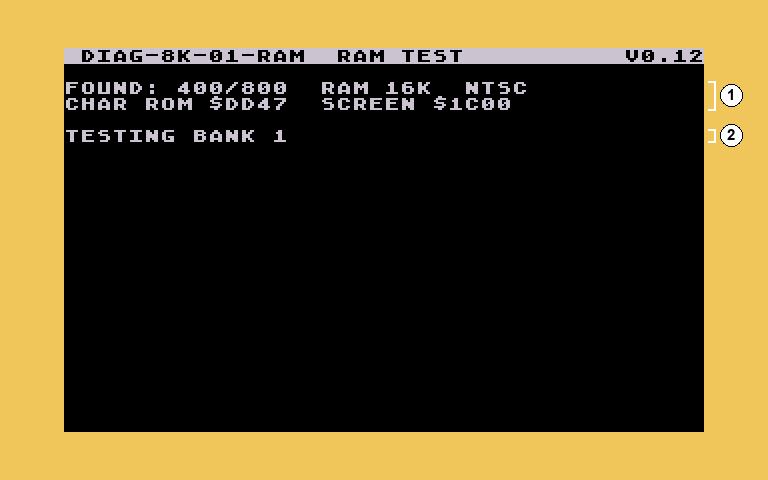

1. What the program found: the machine, its RAM and video standard, the
   character set's checksum and where it put the screen.
2. The bank being tested now.

**Result** (the 8k tape, and the 32k+ tape after the main RAM; the 16k
tape goes straight on to its summary). On 16K and up a key goes on to the
rest of the RAM test.

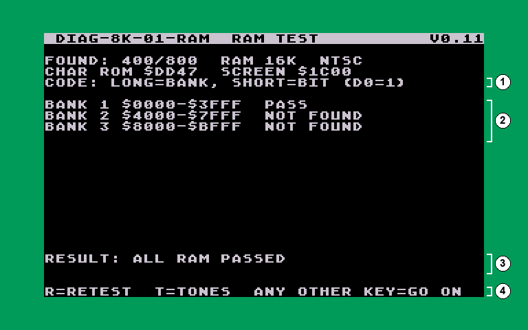

1. How to read the code.
2. One line per 16K bank: PASS, FAIL, or NOT FOUND (no RAM there).
3. The overall result.
4. The keys (see [Keys](#keys)).

When a bank fails, its line shows the bad data bits:


1. How to read the code.
2. The failed bank and its bad bits. On an 800XL each data bit is one RAM
   chip; see [When something fails](#when-something-fails).
3. The overall result. The border flashes red with the code: here long ×1
   (bank 1), short ×5 (bit D4).

**Summary** (machines with 16K or more). Next the tape tests the RAM it
ran in itself (the "loader area"), then on an XL/XE the RAM under the
operating system and, on a 130XE, the four extra banks. Then it shows
everything. The 8k tape's second part:

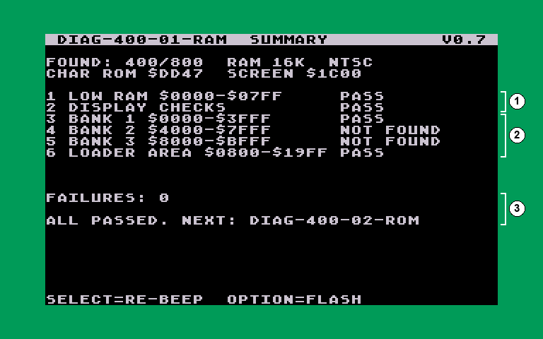

1. Low RAM and the display checks.
2. Every bank, and the area the tape itself ran in. On an XL/XE also the
   RAM under the OS, and on a 130XE the extra banks.
3. The number of failures and the next tape. R runs the RAM test again;
   any other key plays the tones again.

`diag-16k-01-ram` does it all in one load: it tests its own RAM page by
page, moving each page into the screen (the top rows show a jumble for a
moment), testing it and putting it back:

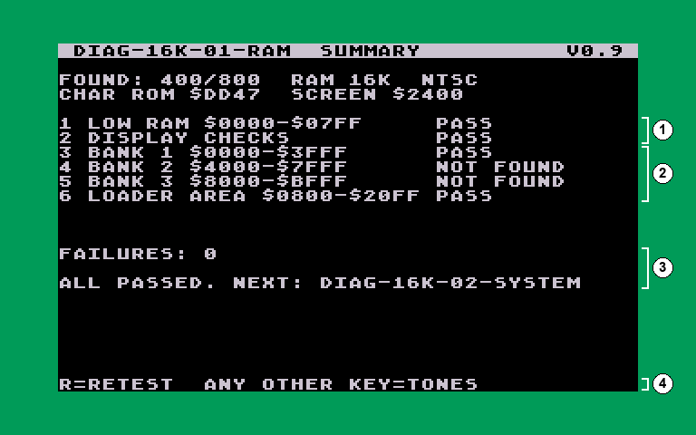

1. Low RAM and the display checks.
2. Every bank, and the area the tape itself ran in.
3. The number of failures and the next tape. A failure shows its first bad
   address and bits, with a hint (one bit: one RAM chip).
4. R runs the whole RAM test again; any other key plays the tones again.

### A cartridge in the way

A cartridge (BASIC, or any other) switches off the 8K of RAM it sits over,
$A000-$BFFF, and nothing can switch it back on. So when the RAM reaches
the cartridge (a 48K 400/800, or any XL/XE but a 16K 600XL), the RAM test
can't test all of it, and says so:
- at the start, white flashes and a sound like typing; then it tests the
  RAM it can reach.
- A fault there is reported as ever: red, the code, `FAIL`.
- With no fault it never says PASS. Bank 3's line says `CART IN WAY`, the
  result line `CARTRIDGE IN: $A000-$BFFF NOT TESTED` (a tape's summary
  still names the next tape below it), and the result plays the typing
  again, in white, instead of the charge.
- On the menu, line 0 says `CART IN WAY`, and the final code is the
  partial one (steady yellow and one chirp).

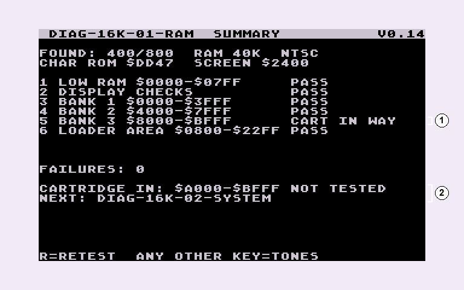

1. Bank 3: its top 8K sits under the cartridge.
2. The line in place of `ALL PASSED`, and the next tape.

Take the cartridge out and test again; check BASIC on its own with
[BASCRC](#bascrc-the-basic-check-on-its-own). (A 40K 800 with a
cartridge in gets the warning too: the test can't tell it from a 48K one.)
The diag cartridge never warns: it switches itself off to test the RAM
under it.

### ROMs (test 1)

The test reads every ROM chip, works out its CRC32 checksum and looks it
up in a table of Atari's own ROMs (published tables, see
[DEVELOPMENT.md](DEVELOPMENT.md), not any one machine's).

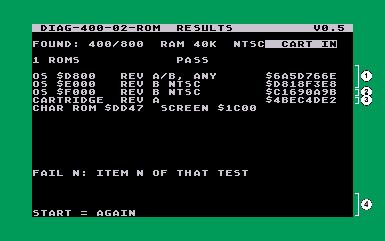

1. The 400/800's three OS chips, each named on its own, with its CRC32. A
   repaired board can have chips from different revisions; the test spots
   that (item 5).
2. The program checking itself against a CRC32 the build stored in it:
   the tape (or the boot disk's test) as it sits in RAM, or the
   cartridge's program banks. `SELF-CHECK FAILED` (item 6) means the copy
   in RAM has changed since it loaded (bad RAM under it), or the
   cartridge's ROM has.
3. BASIC: a BASIC cartridge, if one is in, and its revision (see
   [BASIC cartridges](#basic-cartridges)); `NONE` without one, and always
   on the diag cartridge, which takes the slot itself. Here one is in, so
   the `FOUND:` line says `RAM 40K`.
4. The character set's checksum.
5. The result. It waits for a key, so you can read the names; on
   `diag-8k-02-rom` it is the end of the tape (R runs it again).

On an XL/XE the OS is one 16K chip, named as a whole:


1. The OS. `UNKNOWN` (in inverse) means it matches no Atari ROM in the
   table: a patched, replacement, failing or badly seated chip.
2. The self-check, as above.
3. BASIC, built into the XL/XE (or a cartridge in its slot), and its
   revision (A, B or C). `UNKNOWN` is a fault (item 2): the built-in ROM
   is always one of them. `NONE` on a 1200XL with no cartridge in.
4. The character set's checksum.
5. The result.

### BASIC cartridges

Take BASIC out for the tests, and check it on its own with BASCRC
(below). With a cartridge in, the 8K of RAM under it can't be tested (a
48K 800 shows `RAM 40K`, and the RAM test says `CART IN WAY`: see
[A cartridge in the way](#a-cartridge-in-the-way)): nothing can switch a
plain cartridge out, on a 400/800 or an XL/XE. And with it out, it can't
be the cause of a fault.

If one is left in, a tape or a disk still runs: the OS boots the tape or
disk before it would start BASIC, and the tests never hand the machine
back to it. The ROM test then reads the cartridge ($A000-$BFFF) and names
it, as it does an XL/XE's built-in BASIC: `REV A`, `REV B` or `REV C`,
with its CRC32. `UNKNOWN` (item 2) means it matches no revision: a
failing BASIC cartridge, dirty contacts, or a cartridge that isn't BASIC
(see below). Clean the contacts (see
[When something fails](#when-something-fails)), reseat it, and test
again. The diag cartridge can't check a BASIC cartridge: it takes the
slot itself, so its ROM test shows `BASIC NONE` on a 400/800.

**Other 8K cartridges.** The ROM test reads any cartridge in the slot the
same way, but its table has only BASIC, so another one shows `UNKNOWN`
and fails item 2. Its CRC32 is still right: compare it with a good
copy's (the CRC32 of an 8K `.rom` dump, or of a `.car` file without its
16-byte header). Run the test twice: a CRC32 that changes means the
cartridge reads unreliably. It works only with an 8K cartridge at
$A000-$BFFF (of a 16K one, only the top 8K is read), and only when the
tape or disk still loads with it in: many cartridges start themselves, or
stop a disk from booting. As with BASIC, the RAM under it can't be tested
meanwhile.

### BASCRC: the BASIC check on its own

BASCRC checks a BASIC cartridge (or an XL/XE's built-in BASIC) and
nothing else: it works out the CRC32 of $A000-$BFFF and names the
revision, as the ROM test does. Check BASIC with it, then take the
cartridge out for the other tests.

**The BASCRC disk** (`disks/diag-bascrc.atr`), with a disk drive or an
SIO adapter: put it in drive 1 (or mount it as D1:), the cartridge in,
and switch on. It boots straight into the check, in machine code, with
no DOS, and prints the CRC32, the revision byte and `REV A: GOOD` (or B,
C), or `NO MATCH`. A key ends it: with BASIC there you get its `READY`.
On an XL/XE it switches the built-in BASIC in itself if it is off. It is
a DOS 2 disk too, with `BASCRC.XEX`, the same check to run from DOS (`L`,
then the name; a key goes back to DOS), and `BASCRC.LST`, the BASIC
program below as a listing.

**The BASIC program:**

1. Switch on with the BASIC cartridge in (no START held), to `READY`.
2. Load BASCRC, one of three ways:
   - **Tape** (`cassettes/diag-bascrc`): type `ENTER "C:"` and press
     RETURN (not `CLOAD`, which only reads a program saved with `CSAVE`:
     on this listing it stops with `ERROR- 21`). It beeps once: start the
     tape and press a key. It reads for about a minute, stopping between
     blocks. The tape has to be at its start for every try: after an
     error, or a CLOAD, rewind it.
   - **Disk:** with DOS booted, put the BASCRC disk in drive 1 (or copy
     `BASCRC.LST` onto your DOS disk) and type `ENTER "D:BASCRC.LST"`.
   - **Type it in** (below). Line 40 catches a typing mistake in the
     numbers before anything runs.
3. Type `RUN`.

It prints the CRC32 and `PEEK(43234)` (the byte that says the revision,
for a cross-check), then `REV A - GOOD`, `REV B - GOOD` or `REV C -
GOOD`. `NO MATCH - BAD OR UNKNOWN ROM` with a `PEEK(43234)` that names a
revision (162 A, 96 B, 234 C) points at the ROM or the cartridge's
contacts: clean them, reseat it, and run it again. A badly failing
cartridge may not get BASIC far enough to run it at all.

```
1 REM BASCRC: BASIC ROM CRC32 (A8 ATARI DIAG SUITE)
10 DIM H$(16),C$(8)
20 H$="0123456789ABCDEF":C$=""
30 FOR I=0 TO 108:READ B:POKE 1536+I,B:S=S+B:NEXT I
40 IF S<>15058 THEN PRINT "DATA TYPO - CHECK LINES 1000-1070":END
50 PRINT "CHECKING...":X=USR(1536)
60 FOR I=1779 TO 1776 STEP -1:B=PEEK(I)
70 D=INT(B/16):C$(LEN(C$)+1)=H$(D+1,D+1)
80 D=B-D*16:C$(LEN(C$)+1)=H$(D+1,D+1)
90 NEXT I
100 PRINT "CRC32: ";C$;"   PEEK(43234)=";PEEK(43234)
110 IF C$="4BEC4DE2" THEN PRINT "REV A - GOOD":END
120 IF C$="F0202FB3" THEN PRINT "REV B - GOOD":END
130 IF C$="7D684184" THEN PRINT "REV C - GOOD":END
140 PRINT "NO MATCH - BAD OR UNKNOWN ROM":END
1000 DATA 104,169,255,141,240,6,141,241,6,141,242,6,141,243
1010 DATA 6,169,0,133,203,169,160,133,204,160,0,177,203,77
1020 DATA 240,6,141,240,6,162,8,78,243,6,110,242,6,110
1030 DATA 241,6,110,240,6,144,32,173,243,6,73,237,141,243
1040 DATA 6,173,242,6,73,184,141,242,6,173,241,6,73,131
1050 DATA 141,241,6,173,240,6,73,32,141,240,6,202,208,207
1060 DATA 200,208,194,230,204,165,204,201,192,208,186,162,3,189
1070 DATA 240,6,73,255,157,240,6,202,16,245,96
```

The reference CRCs are MAME's (`hash/a800.xml`): A `4BEC4DE2`, B
`F0202FB3`, C `7D684184`.

### Keyboard and console keys (tests 2 and 3)

**Keyboard.** Press every key; a console key or fire ends the test. Each
key on the map shows one of three states, without needing colour, so
this works on a black-and-white screen too:


1. The key map. Not pressed yet: normal. Done: inverse. Held down now:
   inverse, blinking. The four arrow keys are CONTROL with `-` `=` `+`
   `*`, so those keys carry the arrows. CONTROL lights only together with
   another key: the Atari can't see CONTROL on its own.
2. The legend.
3. How many keys are left. HELP (XL/XE) and F1-F4 (1200XL) show but
   aren't required.

If keys are missing, the result screen shows the pressed keys in inverse,
so the missing ones stand out:


1. The map: inverse = pressed, normal = never pressed.
2. The legend for this screen.
3. Keys left.
4. The result and the failed items (item 1: a key was already held at the
   start, a stuck key; item 2: keys never pressed).
5. The keys.

**Console keys.** Press START, SELECT and OPTION. Then the console speaker
plays a tone over and over until you answer.

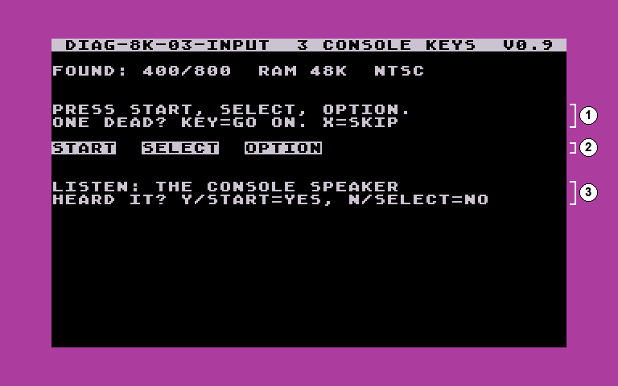

1. What to do. If one of the three keys is dead, any other key or fire
   goes on (and that key is marked failed); X skips the test.
2. The keys seen so far, in inverse.
3. The question about the speaker: Y or START = yes, N or SELECT = no. The
   border is purple while it waits.

### Joysticks and paddles (tests 4 and 5)

**Joysticks.** Move each joystick and press its button. Each direction and
the button show inverse while active. START or any key ends the test.

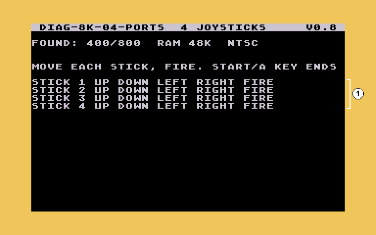

1. One line per port: four on a 400/800, two on an XL/XE. Something
   already active at the start counts as stuck (item = port).

**Paddles.** First the screen asks you to unplug all paddles and press a
key: with nothing plugged in, every paddle input must read 228 (SELECT
skips this open-input check). Then plug the paddles back in and turn each
one. START or any key ends the test.


1. What to do.
2. The column headings: the value now, the lowest and highest seen (a full
   turn reaches about 1 and 228), and the jitter.
3. One line per paddle, with a bar. Here nothing is plugged in, so every
   one reads 228. Jitter is how much the value wobbles with the knob
   still: a large jitter means a dirty or worn paddle. A `T` at the end
   means the paddle's button is pressed.

**The end of a tape.** The paddles are `diag-8k-04-ports`' last test, so
its screen stays up with the tape's results under it. Every tape without
a menu ends this way (the 8k tapes 02-06, `diag-16k-03-hello` and
`diag-controls`, and their disks): the last test goes straight there, and
the pass or fail sound plays once, for the whole tape.

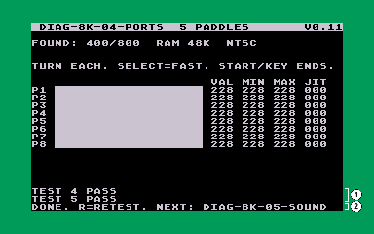

1. A line for each test on the tape.
2. What to load next. R runs the tape's tests again; any other key plays
   the tones again. Nothing needs a press: you can leave it here.

### Sound and video (tests 6 and 7)

**POKEY.** The sound chip's timer and random-number generator are checked
automatically. Then each of its four voices plays, one at a time, over and
over until you answer whether you heard it (items 3-6): first a rising
scale, eight notes from C to C, then noise, a steady hiss. The noise comes
from a part of the chip the pure tones don't use. A voice that plays some
notes wrong, or no hiss, counts as not heard.


1. The automatic checks are done.
2. The voice playing now.
3. The question: Y or START = yes, N or SELECT = no.

**"hello"** (item 7: the cartridge, `diag-16k-03-hello`, and with 16K the
boot disk and the disk set's sound disk): the word "hello", a short
recording, seven times. The first four plays use each voice's volume
control as a 4-bit sample player; the fifth uses the console speaker,
which is only on or off, so it sounds rougher; the last two use two voices
at once (1+2, then 3+4), which doubles the levels and sounds clearer.
Answer whether you heard them all. The screen goes dark while it plays:
the video chip borrows the processor on every line it draws, which would
make the samples late and uneven. Every version plays the same recording
(a public-domain one; see [DEVELOPMENT.md](DEVELOPMENT.md#attributions)),
a sample every scan line (15.7 kHz), packed to half its size and unpacked
as it plays: the cartridge from a bank of its own, the disks and the tapes
from RAM, which is why they need 16K for it.

**GTIA/ANTIC.** One screen: eight brightness steps, sixteen colours (in
bands bigger than the gray steps), and under them the sprites: the word
ATARI, made of the four players and the four missiles, with the letters
taken from the character ROM, scrolling from right to left in rainbow
colours that move down the letters. Each letter rides a wave up and down,
a little behind the one before, so the word snakes as it goes. Answer
whether it all looks right (item 1). Without a working screen the test is
skipped.


This picture is from version 0.9, when the video test was on the tape
`diag-8k-05-av`; only the title bar has changed since.

1. The video standard, PAL or NTSC, as the machine reports it.
2. Eight even steps from black to white.
3. Sixteen different colours.
4. ATARI, moving (the picture catches it at one moment).
5. The question: does it look right?

**Page 2: the video modes** (`7 VIDEO MODES`) comes after a yes on page
1. Each mode has a line of text above it saying what it is:

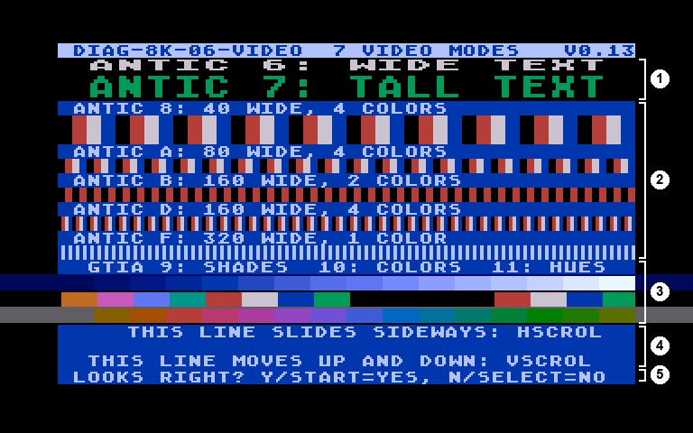

This picture is from version 0.13; only the version in the title bar has
changed since.

1. `ANTIC 6` and `ANTIC 7`: big text, wide and white, then tall and green.
2. The bitmaps `ANTIC 8`, `A`, `B`, `D` and `F`, from coarse to fine: each
   is filled with even bars of its colours (the 4-colour modes: black, red,
   white, blue; the 2-colour ones: stripes). Each band should be even all
   the way across, the bars getting finer from one band to the next.
3. `GTIA 9, 10, 11`: three bands of the same line of 16 values: 16 shades
   of blue, then 9 colours, then 16 hues.
4. A line that slides from side to side (ANTIC's fine horizontal scroll,
   `HSCROL`) and one that moves up and down a scan line at a time (fine
   vertical scroll, `VSCROL`). The picture catches them at one moment.
5. The question, which stays still.

Answer whether it all looks right (item 2).

### The tapes' menu (`diag-16k-02-system`, `diag-32k-xl-xe`)

On machines with 16K or more, all seven tests are on one tape, with a
menu:


1. The tests, in order, with their state: `-` not run yet, PASS, or FAIL
   and the failed items.
2. The results and the final code.
3. The keys: START runs the highlighted line (test 1 when the menu first
   appears), SELECT moves down, OPTION moves up, 1-8 run that line; a
   joystick works too. After a test the next one is highlighted, so START
   again and again goes through them all.

Running a test again replaces its old result.


1. Every test: PASS, FAIL and its items, or `-` if not run. Here test 7
   wasn't run, so the final result is yellow (nothing failed, but not
   everything was tested) with the start-up chirp.
2. The ROMs (see [ROMs](#roms-test-1)).

### The 32k+ tape (`diag-32k-xl-xe`)

One tape, one load, for any machine with 32K or more:
1. The RAM test: everything above the program gets the full test.
2. The program's own RAM, page by page: each page is moved into the screen
   (the top rows show a jumble for a moment), tested, and put back.
3. On an XL/XE: the RAM under the OS and, on a 130XE, the four extra banks.
4. The RAM summary:


1. Low RAM and the display checks.
2. Every bank, the area the tape ran in, and here (an XL) the RAM under the
   OS as bank 4.
3. The result and what's next.
4. It goes on to the ROM test, then the menu: by itself after its code
   has played three times (`LEFT ALONE, IT GOES ON AFTER 3 CODES`), or at
   once on a key. T or OPTION stops the count.

5. The seven tests, with the menu:

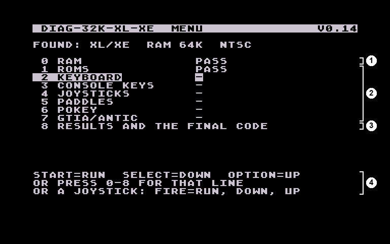

1. `0 RAM`: the whole RAM test again from the start, with the RAM result
   so far beside it. After the RAM summary (a key, or three codes) you are
   back at this menu, with the other tests cleared to `-`.
2. The tests.
3. The results: the page shown above, with one more line on top, test 0,
   the RAM. FAIL there lists the bad banks, and the final code plays one
   long beep, then short × bank.
4. The keys, joystick included, as on every menu (0-8 run a line).

During the ROM test the screen goes blank for about a third of a second:
the test is reading the XL/XE's self-test ROM, which sits where this tape
keeps its screen.

### Controls only (`diag-controls`)

The keyboard, joystick and paddle tests from above, on one tape for 16K
and up, with nothing else: no menu, no RAM or ROM test. They run in order,
and at the end R runs them again. It goes with Atari's SALT diagnostic
disks, whose controller tests need a test harness plugged in; this tape
doesn't.

### Memory test (line 9)

The memory test (a burn-in) repeats the RAM tests until you press a key:
leave it running for an hour or a day to catch faults that only show when
the machine is warm. It keeps a clock, counts passes, and logs every bad
bit: in which pass it first failed, and in how many passes since. A bit
that failed every time is **solid**; one that only fails sometimes is
**intermittent**.

What each one covers:
- **`diag-16k-memtest`** (16K or more; also line 9 of the cartridge and
  the boot disk): all the RAM, that is main RAM, the RAM under an XL/XE's
  OS and a 130XE's extra RAM, except the last page under the OS,
  $FF00-$FFFF, which holds the test's own interrupt vectors while the OS
  is switched out (the RAM tapes test that page).
- **`diag-8k-memtest`** (8K or more): main RAM only, which is all the RAM
  a 400/800 has. It can't reach an XL/XE's extra RAM, so on an XL/XE it
  stops at once rather than run an incomplete test. With no room to spare
  in 8K, it takes only fire from a joystick (not down or up) and has no
  [stuck joystick](#a-stuck-joystick) check; a stuck one still can't hold
  it up.

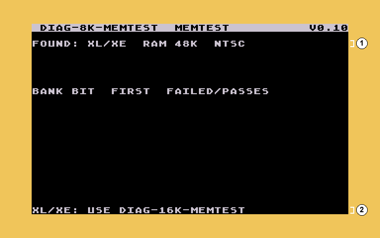

1. An XL/XE (its main RAM only: this tape doesn't look further). The
   border is yellow.
2. Load `diag-16k-memtest` instead.

A pass, as the `NOW:` line shows it. **`diag-16k-memtest`:**
1. `LOW RAM`: $0000-$07FF, every byte saved, tested and put back.
2. `ALL THE RAM, ONE MARCH`: March C- over all the RAM at once, the RAM
   under an XL/XE's OS included: first with $00/$FF, then with $55/$AA.
   It finds stuck bits, bits that change their neighbours, and bad
   address lines.
3. `REFRESH CHECK: THE SCREEN GOES OFF`: the RAM is filled with $00, then
   the screen goes off (all of it shows the border colour) and the test
   leaves the RAM alone for 5 seconds (all but its own short wait loop),
   so only the machine's refresh keeps it;
   then it is read back, and the same again with $FF: about 12 seconds in
   all. Every read or write also refreshes the RAM, so the march can't see
   a refresh fault, such as a replacement RAM chip that needs more of the
   refresh than an older ANTIC gives. A key still ends the test after the
   pass.
4. `130XE BANKS 5-8`: each extra bank, then the banks against each other
   (with the same 5-second wait, so the screen goes off once more).

A pass takes about half a minute on a 48K 800.

**`diag-8k-memtest`:** `LOW RAM`, then the march on each 16K bank in turn
(`BANK 1`, 2 ...), then `ADDRESSES` over all of them: every byte given its
own address and checked, for bad address lines. There's no room in 8K for
the refresh check.


1. The passes done (`PASSES 0` during the first) and how long it has run.
2. What it's testing now (see the list above).
3. The log: bank (B1-B8; B9 is the memory test's own RAM, when it tests it
   page by page), bit, the first pass it failed in, and failed/passes.
   Here bit D2 of bank 2 has failed in all three passes: a solid fault.
4. A key (or START, SELECT, OPTION or a joystick button) ends the test
   after the pass in progress: the line then says `ENDING AFTER PASS`.

The border shows the state so far: green no errors, red solid errors only,
yellow if anything intermittent has been seen.

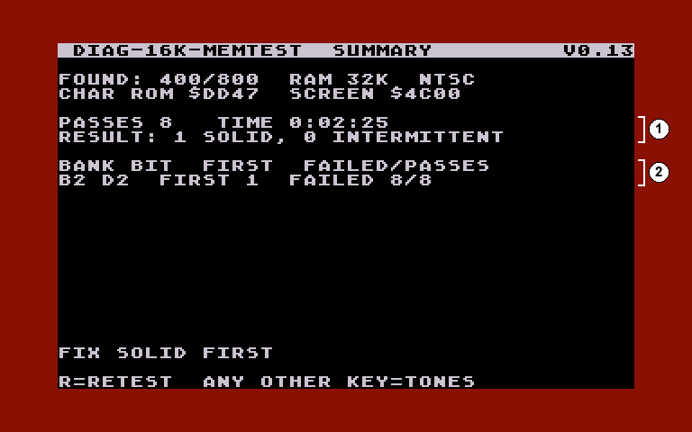

1. The passes done, the time and the result. Under the log, what to do
   (`FIX SOLID FIRST`, or `ALL PASSED`). R starts the memory test again;
   any other key plays the tones again (on the cartridge and the boot
   disk: T the tones, any other key the menu).
2. The log.

The memory test also tests the RAM it runs in:
- **`diag-8k-memtest`**, and **`diag-16k-memtest` on 16K:** each page of
  its own code is moved aside, tested and put back, every pass. While that
  happens the top of the screen shows the page being worked on, as a
  jumble of characters.
- **`diag-16k-memtest` on 32K and up:** it keeps two copies of itself that
  take turns, each testing the other's RAM, so the RAM it sits in gets the
  same full test as all the rest.

Every pass, both memory tests also test the screen's own RAM where you can
see it: an inverse bar runs down the screen, one row at a time. Each row
is inverted, held for two frames, checked, put back and checked again.


1. The row being tested. A blank row shows as a row of arrows: that's what
   a space looks like with every bit flipped. The `NOW:` line is blank
   while the bar runs.

## When something fails

**Dirty contacts cause a lot of "faults".** An unpaid recommendation from
the author: DeoxIT contact cleaner (CAIG Laboratories) on the cartridge
port, the cartridge's own contacts, the SIO and joystick connectors, and
an 800's RAM and OS board edges. Clean, reseat, and test again before
blaming a chip.

- **Note the code** (or the screen). Long beeps say where, short beeps say
  which bit or item.
- **RAM:** a bad bit in one bank usually means one RAM chip. On an 800XL
  each data bit (D0-D7) is one chip, across all of the 64K. On a 400/800
  each 16K board has its own chips, so the bank tells you which board. The
  same bad bit in every bank points at something shared: a data line, a
  socket, or a buffer chip.
- **Run the memory test** on a machine that passes but misbehaves, or
  after a repair. Intermittent faults often only show when the machine is
  warm.
- **Fall back to the 8k set** (tapes or the disk set) when a machine can't
  get through the boot disk or its own tapes. It only needs the first 8K
  of RAM. In particular:
  - no green chirp after loading: the RAM it loaded into is bad
  - one long beep then the low beep, with no picture: it didn't load into
    RAM correctly
  - a crash or a hang (the border stays yellow and silent) partway through
- **Red border and the low tone on and off, right after loading:** not a
  fault. The tape needs more RAM than the machine has; use a smaller set.
- **A tape or disk that won't load at all**, or a BOOT ERROR: first load
  it again (one failed load means nothing). If it fails every time, it
  points at the first part of RAM, or the cassette, disk or SIO
  connection.

## Other ways to run it

The cartridge and the boot disk do everything on every machine. The disk
set has the 8k tapes' tests, one to a disk. The cassettes need no disk
drive and no flash cartridge, only a cassette recorder (or a PC playing
the tape) on the SIO port.

### The disk set

The `disk-set` folder holds the 8k tapes as disks:
`diag-8k-01-ram.atr` to `diag-8k-06-video.atr` and `diag-8k-memtest.atr`.
Each is named as its tape and holds the tape's own program, so it shows
the same screens. Switch on with one in drive 1 (or mounted as D1:), with
no DOS and no cartridge: the test starts as soon as it has loaded, a few
seconds, and its last screen names the next disk, for example
`DONE. R=RETEST. NEXT: DIAG-8K-04-PORTS`. They are the tapes' programs
unchanged, so two lines still say tape: the ROM disk's self-check line
reads `DIAG TAPE`, and the video disk ends with `LAST 8K TAPE`.

They are for a machine the boot disk can't get far on. The boot disk
starts with the RAM test and keeps loading pieces from the disk as you go;
each disk in the set loads once and runs only its own test, as a tape
does, so a keyboard or joystick can still be tested when something else
is failing.

With 16K or more, three of them do more than their tapes:
- `diag-8k-01-ram.atr`: after its result, a key goes on to part 2, read
  from the same disk by itself. Part 2 tests the RAM part 1 sat in, and an
  XL/XE's extras. On 8K it ends with `STAGE 2: 16K ONLY. NEXT:
  DIAG-8K-02-ROM`, as the tape does.
- `diag-8k-05-sound.atr`: the sampled "hello" too (item 7), as on the boot
  disk.
- `diag-8k-memtest.atr`: it runs `diag-16k-memtest` instead (the title bar
  says so), which reaches all the RAM, an XL/XE's too.

If a disk won't read, the OS shows `BOOT ERROR` and tries again. The sound
and memory test disks pick their program after the boot: a sector that
won't read there turns the screen red with a low tone, and a key, START or
fire tries again.

The memory test has a disk of its own too, in the `disks` folder:
`diag-16k-memtest.atr` boots straight into it.

### Cassettes

**Why cassette.** A cassette boot needs only the computer, its OS ROM,
the first few K of RAM and the SIO port: no disk drive, no DOS, no flash
cartridge. So it runs on the smallest machine there is, a 400 with 8K,
and on a machine too sick to boot a disk. Each tape loads into the bottom
of RAM and tests everything else from there. The cartridge needs less
still (it loads nothing into RAM), and it and the boot disk are quicker
and do everything the tapes do; use the tapes when there's only a
cassette recorder (or a PC playing the tape), or when the machine is too
sick to boot a disk.

**Several sets, because tape is slow.** A cassette loads at 600 baud,
about 3K a minute, so the tests are split by how much RAM the machine has:
the more RAM, the fewer tapes. A set works on every machine with at least
that much RAM, whatever the model, so any Atari can run the 8k set and a
130XE all three; the bigger set is just quicker. Within each set, every
tape only relies on what an earlier one proved: RAM is tested before
anything else runs from it, and the keyboard before a test asks a yes/no
question.

### Which tapes for which machine

**Use the biggest set your machine has the RAM for**, in this order:
- **8K or more**, the 8k set: `diag-8k-01-ram` to `diag-8k-06-video`, six
  small tapes of about 2 minutes each; memory test `diag-8k-memtest`
  (400/800).
- **16K or more**, the 16k set: `diag-16k-01-ram`, `diag-16k-02-system`
  (and `diag-16k-03-hello`, the sound test with the sampled "hello"),
  about 2.5 to 3.5 minutes each; memory test `diag-16k-memtest`.
- **32K or more**, the 32k+ tape: `diag-32k-xl-xe`, one tape of about 5
  minutes; memory test `diag-16k-memtest`.

For the keyboard, joysticks and paddles only: `diag-controls` (16K or
more). **When a machine won't get through its own set**, use the 8k set:
it needs only the first 8K of RAM to work, so it's the fallback for every
machine.

How much RAM the models came with (an upgraded machine counts what it has
now):

| Model | RAM |
|---|---|
| 400 | 8K or 16K |
| 800 | 8K to 48K |
| 600XL | 16K, or 64K with a 1064 memory module |
| 1200XL, 800XL, 65XE, 800XE, XE Game System | 64K |
| 130XE | 128K |

Not sure how much RAM there is? Load `diag-8k-01-ram`: it runs on every
Atari and shows the RAM it found. Or just try a bigger tape: one that
needs more RAM than the machine has stops at once with a red border and a
low tone, on and off.

All the tapes:

| Tape | Needs | Load time | Tests |
|---|---|---|---|
| `diag-8k-01-ram` | 8K | 2 min, then 1.5 min for part 2 | the display checks and all the RAM. Part 2 (machines with 16K or more): the RAM the tape itself used, the RAM under an XL/XE's OS and a 130XE's extra RAM |
| `diag-8k-02-rom` | 8K | 2 min | test 1, the ROMs |
| `diag-8k-03-input` | 8K | 2 min | tests 2 and 3, the keyboard and the console keys |
| `diag-8k-04-ports` | 8K | 2 min | tests 4 and 5, the joysticks and the paddles |
| `diag-8k-05-sound` | 8K | 1.5 min | test 6, the sound (POKEY) |
| `diag-8k-06-video` | 8K | 2 min | test 7, the video (GTIA/ANTIC), both pages |
| `diag-8k-memtest` | 8K | 2 min | the memory test, until you stop it (a 400/800's RAM; on an XL/XE it stops at once: use `diag-16k-memtest`) |
| `diag-16k-01-ram` | 16K | 2.5 min | the whole RAM test in one load: all the RAM, the tape's own, under an XL/XE's OS, and a 130XE's extra RAM |
| `diag-16k-02-system` | 16K | 3.5 min | tests 1-7, with a menu |
| `diag-16k-03-hello` | 16K | 3 min | the sound test (test 6) with the sampled "hello" (item 7): too big for 8K |
| `diag-32k-xl-xe` | 32K | 5 min | the whole RAM test, then tests 1-7 with a menu, in one load |
| `diag-16k-memtest` | 16K | 2.5 min | the memory test, until you stop it (all the RAM) |
| `diag-controls` | 16K | 2 min | tests 2, 4 and 5 only: keyboard, joysticks, paddles |
| `diag-bascrc` | BASIC in | about 1 min | BASCRC, the BASIC check, as a listing for `ENTER "C:"` (see [BASCRC](#bascrc-the-basic-check-on-its-own)) |

`diag-8k-01-ram-part2` is the second part of the 8k RAM tape as a file of
its own. A machine with 8K never loads it (the screen says `STAGE 2: 16K
ONLY. NEXT: DIAG-8K-02-ROM`); a bigger machine running the 8k set does.
You only need it with a player that can't wait between the two parts (see
[AspeQt](#from-a-pc-usb-sio-interface-and-aspeqt)).

On an XL/XE, `diag-8k-01-ram`'s first part shows `RAM 48K`: the main RAM
it tests. The RAM under the OS and a 130XE's extra RAM are part 2's, on a
machine with 16K or more.

### Loading a tape

#### Starting the machine for a cassette boot

1. Turn the Atari off.
2. **Take out any cartridge**, except BASIC if you want the ROM test to
   check it. A tape boots with a cartridge in (START held), as a disk
   does, but a cartridge covers 8K of RAM, which the RAM test can't
   reach: a 48K 800 with BASIC in shows `RAM 40K`. An XL or XE's built-in
   BASIC doesn't matter: the tapes switch it off themselves.
3. Hold **START** and turn the Atari on, still holding START. It beeps
   once.
4. Start the tape, then press any key on the Atari.

When the tape has loaded, the border turns green and you hear a rising
chirp: the machine is running the test.

If a load fails (BOOT ERROR, or a crash before the green chirp), load it
again: turn the Atari off, rewind or reload the tape, and start over. A
load that works on the second try is fine; the tape is good. Only a load
that fails every time, at the same point, means something is wrong.

#### From a PC: USB-SIO interface and AspeQt

A USB-to-SIO interface (an "SIO2PC" cable; for example the SIO2PC-USB)
plugs into the Atari's SIO port (the one the disk drive and cassette
recorder use) and into a PC's USB port, where it shows up as a COM port.
The free program [AspeQt](https://sourceforge.net/projects/aspeqt/) can
then play a `.cas` file into the Atari as if it came from a cassette
recorder.

Setting up AspeQt (Tools > Options):
- **Serial port:** the COM port the interface uses (Windows Device Manager
  shows it).
- **Handshake:** the method your interface uses (its manual says which).
- **Cassette speed:** leave "Use custom baud rate for cassette emulation"
  off: the tapes are 600 baud, the normal speed.

AspeQt's manual recommends interfaces built on an FTDI USB chip, and says
the AtariMax "SIO2PC Universal Interface USB Edition" isn't supported.

To play a tape:
1. In AspeQt, choose **File > Playback cassette image** and pick the
   `.cas` file (or drag the file onto AspeQt). A dialog with instructions
   appears.
2. Do the cassette boot on the Atari (hold START, power on, wait for the
   beep).
3. Press a key on the Atari and confirm AspeQt's dialog at about the same
   time. The tape plays.

AspeQt can't rewind or pause a tape. On a machine with 16K or more,
`diag-8k-01-ram` is a **two-part tape**: the first part runs its RAM test
for a few minutes before it asks for part two, and by then AspeQt has
played past it. The screen then says `STAGE 2: NOT ON TAPE` or `STAGE 2:
ERROR` and a number. When that happens, play `diag-8k-01-ram-part2.cas`
and press a key on the Atari: it tries again. Every other tape is a single
part and doesn't have this problem.

#### From a real cassette recorder

The `.cas` files can be turned into audio (a `.wav` file) with a CAS-to-WAV
converter, and the audio recorded onto a tape for an Atari 410 or 1010
recorder. This hasn't been tried with these tapes yet.

## Questions

### Is this a substitute for the memory test?

No. The RAM tests check every byte with strong patterns, but only once. A
fault that only shows when warm, or now and then, needs the memory test
running for a while. Only the memory test (16K and up) checks the refresh
as well: see [Memory test](#memory-test-line-9).

### Does a pass prove the machine is good?

It proves what was tested: RAM, ROMs, the keyboard, the console keys, the
controller ports, and the sound and video chips as far as you could see
and hear them. The SIO port gets a workout just by loading. It doesn't
test a disk drive or a printer, and the cartridge slot only as far as the
ROM test reads a BASIC cartridge in it.

### What has it been tried on?

Real 800 and 800XL machines, over SIO2PC with AspeQt: the boot disk, and
the executables (`.xex`) up to 0.11. The joystick and paddle ports get
their real test there. The cartridge, on an 8 Mbit MaxFlash (0.14), in a
real 48K 800: every test, the results, the self-check, and the 8K under
it (48K shown). Every format has also run on the author's development
set-up, the MiSTer's Atari800 core, as a 400/800 and as an XL/XE (64K
and a 128K 130XE). Not tried yet: a physical disk drive, the 128K
AtariMax cartridge on a real machine, and the cassettes on a real
machine.
